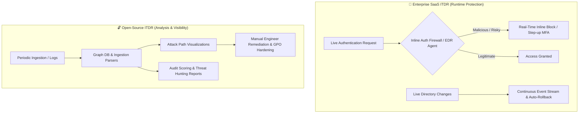

  

# 🛡️ Awesome Identity Threat Detection & Response (ITDR) Ecosystem

  
  
  
  
  
  

> 🔍 A comprehensive, curated directory of premier enterprise SaaS platforms and battle-tested open-source tools for **Identity Threat Detection & Response (ITDR)**, **Identity Attack Path Management (APM)**, Active Directory security, and credential breach prevention.

**Identity Threat Detection & Response (ITDR)** represents the cybersecurity discipline and tooling designed specifically to protect identity fabrics—including on-premises Active Directory (AD), Microsoft Entra ID, Okta, and Cloud IAM providers—from credential compromise, privilege escalation, lateral movement, token theft, and stealth persistence. As modern threat actors increasingly bypass perimeter firewalls and EDR agents by logging in with legitimate credentials, ITDR provides the missing runtime behavioral analytics, attack path graphing, and autonomous access containment needed to stop breaches before adversaries reach crown-jewel assets. ⚡

---

## 📑 Table of Contents

- [📊 Sector Overview & Market Dynamics](#-sector-overview--market-dynamics)
- [🏢 Enterprise SaaS & Commercial ITDR Platforms](#-enterprise-saas--commercial-itdr-platforms)
- [🔓 Open-Source ITDR & Active Directory Security Projects](#-open-source-itdr--active-directory-security-projects)
- [🏗️ Key Architectural Differences: SaaS vs. Open-Source](#️-key-architectural-differences-saas-vs-open-source)
- [🤝 How to Contribute](#-how-to-contribute)
- [⭐ Star History](#-star-history)
- [💖 Support & Community](#-support--community)
- [⚖️ Disclaimer & License](#️-disclaimer--license)

---

## 📊 Sector Overview & Market Dynamics

The global **Identity Threat Detection and Response (ITDR)** market is estimated at **$12.8 billion** and projected to exceed **$35.6 billion** by 2030, advancing at a Compound Annual Growth Rate (CAGR) of **~22.6%**. 

The market is **moderately fragmented yet rapidly consolidating**, characterized by foundational identity infrastructure titans (Microsoft, CrowdStrike) acquiring niche innovators (e.g., Okta acquiring Spera Security, Delinea acquiring Authomize) alongside specialized pure-play unicorns (Silverfort, Semperis) competing on patented inline authentication firewalls and deep hybrid-Active Directory cyber resilience. 📈

---

## 🏢 Enterprise SaaS & Commercial ITDR Platforms

The following matrix benchmarks prominent commercial ITDR solutions sorted in descending order by enterprise company scale (market capitalization or latest enterprise valuation). 💼

| Platform | Company Valuation / Revenue | Pricing Model (Starting Tier) | Free Tier Limit / Free Trial Policy | Primary Focus & Core Differentiator |
| :--- | :--- | :--- | :--- | :--- |
| **[Microsoft Entra ID Protection](https://learn.microsoft.com/en-us/entra/id-protection/overview-identity-protection)** | ~$3.88 Trillion (Market Cap) | $10.00 / user / month (Included in Entra ID P2 license; bundled in M365 E5) | 30-day free trial (Up to 100 Entra ID P2 evaluation licenses) | Native risk-based sign-in and user anomaly detection feeding directly into Conditional Access policies. 🛡️ |
| **[CrowdStrike Falcon Identity Protection](https://www.crowdstrike.com/)** | ~$260 Billion (Market Cap) | ~$3.00 – $5.00 / active identity / month (Available via Falcon Enterprise/Elite add-on or AWS Marketplace private offer) | 15-day free trial (Self-service Falcon platform trial with Identity module activation; expandable via sales) | Unified endpoint and identity telemetry; real-time lateral movement blocking and risk-based dynamic MFA. 🦅 |
| **[SentinelOne Singularity Identity](https://www.sentinelone.com/)** | ~$8.7 Billion (Market Cap) | $229.99 / endpoint / year (~$19.16 / endpoint / month via Singularity Commercial tier with ITDR) | 30-day guided PoC trial (Provisioned console via sales/partners; no self-service tier) | Deceptive lures, identity threat detection, and automated containment correlated with Singularity EDR. 🎯 |
| **[Tenable Identity Exposure](https://www.tenable.com/)** | ~$5.4 Billion (Market Cap) | £23.14 (~$29.50) / enabled identity / year (~$2.45 / identity / month via G-Cloud framework; also in Tenable One) | 30-day proof-of-concept trial (Requires directory configuration with 100+ active user identities) | Continuous Active Directory and Entra ID vulnerability exposure scanning without host agents or event logging overhead. 🔍 |
| **[Semperis](https://www.cohesity.com/)** | ~$1.5 Billion – $2.5 Billion Valuation ($100M+ ARR) | Quote-based enterprise subscription per protected AD/Entra account (Typical entry tier ~$15,000 / year) | Free forever community edition available via **Purple Knight** (Unlimited one-off assessments of AD, Entra ID, & Okta; continuous monitoring requires paid enterprise license) | Active Directory cyber resilience, automated malicious modification rollbacks, and clean post-attack forest recovery. 🌲 |
| **[Vectra AI](https://www.vectra.ai/)** | ~$1.2 Billion Valuation (~$130M ARR) | Quote-based tier starting ~$12,000 – $25,000 / year based on monitored IP addresses, cloud accounts, and identities | 30-day to 45-day structured trial deployment (Guided evaluation with Attack Signal Intelligence against live directory/cloud traffic) | Behavior-based AI detecting attacker TTPs across hybrid cloud identities, M365, and enterprise networks. 🧠 |
| **[Silverfort](https://www.silverfort.com/)** | ~$1.0 Billion Unicorn Valuation (~$82M ARR) | Headcount-based subscription starting at ~$15,000 / year on AWS Marketplace (Core, Plus, Advanced, Enterprise tiers) | 14-day to 30-day guided Proof of Concept (Sales/partner engagement; no perpetual free tier) | Patented Runtime Access Protection (RAP); serves as an inline authentication firewall extending MFA to legacy protocols and service accounts. 🏰 |
| **[BeyondTrust](https://www.beyondtrust.com/)** | Clearlake Capital / Francisco Partners Portfolio (~$400M+ ARR) | Modular subscriptions starting at ~$30,000 / year ACV for entry tiers (Password Safe / PRA modules) | 14-day free trial available for Remote Support & Privileged Remote Access; PAM/ITDR modules require guided evaluation | Privileged Access Management (PAM) unified with identity threat detection, CIEM, and JIT access orchestration. 🔑 |
| **[Spera Security (Okta)](https://www.spera.io/)** | Acquired by Okta for ~$80M – $130M (Okta Market Cap: ~$16 Billion) | Integrated into Okta Identity Governance & Posture product tiers | 30-day Okta enterprise evaluation trial (Access to Okta workforce and security capabilities) | Identity Security Posture Management (ISPM) and attack surface minimization across SaaS and enterprise environments. ✨ |

---

## 🔓 Open-Source ITDR & Active Directory Security Projects

Open-source identity security tools excel at **attack path discovery**, **privilege graph analysis**, **audit automation**, and **forensic log investigation**. Below are premier open-source options, sorted in descending order by GitHub stargazers count: 🌟

| Project | GitHub_Stars | Focus Category | License | Description |
| :--- | :--- | :--- | :--- | :--- |
| **[BloodHound Legacy](https://github.com/SpecterOps/BloodHound-Legacy)** |  | Attack Path Analysis | GPL-3.0 | The landmark graph-theory cybersecurity application used to identify complex and unintended relationship chains in Active Directory. 🩸 |
| **[BloodHound Community Edition](https://github.com/SpecterOps/BloodHound)** |  | Attack Path Graphing | Apache-2.0 | Next-generation BloodHound architecture maintained by SpecterOps; provides continuous ingestion, OpenGraph schema, and hybrid AD/Azure privilege graphing. 🌐 |
| **[PingCastle](https://github.com/netwrix/pingcastle)** |  | Active Directory Auditing | Non-Profit OSL 3.0 | Comprehensive Active Directory posture assessment tool evaluating trust relationships, stale objects, anomalous delegations, and compliance health. 🏰 |
| **[BloodHound.py](https://github.com/dirkjanm/BloodHound.py)** |  | Data Collection / Ingestion | MIT | Pure Python ingestor for BloodHound, enabling cross-platform directory enumeration from Linux/macOS without requiring Windows execution. 🐍 |
| **[bloodyAD](https://github.com/CravateRouge/bloodyAD)** |  | Privilege Escalation Analysis | MIT | Lightweight Active Directory privilege escalation and attack path verification framework leveraging LDAP and SAMR protocols. ⚔️ |
| **[CISA Sparrow](https://github.com/cisagov/Sparrow)** |  | Cloud Forensics & ITDR | CC0-1.0 | Developed by CISA Cloud Forensics to detect compromised accounts, malicious Azure AD application consents, and authentication anomalies. 🐦 |
| **[WatchAD](https://github.com/Qianlitp/WatchAD)** |  | AD Intrusion Detection | Apache-2.0 | Python-based Active Directory security intrusion detection engine analyzing Windows event logs in near real-time for Kerberos and NTLM abuses. 👁️ |
| **[Hawk](https://github.com/T0pCyber/hawk)** |  | M365 & Entra Forensics | MIT | PowerShell incident response and threat hunting module gathering sign-in telemetry, forwarding rules, and tenant configuration risks. 🦅 |
| **[ADPulse](https://github.com/dievus/ADPulse)** |  | AD Vulnerability Assessment | MIT | Automated Active Directory scanner inspecting Kerberos configurations, ADCS certificates, LAPS implementations, and risky GPOs. 🩺 |
| **[AD-PathFinder](https://github.com/NetSPI/AD-PathFinder)** |  | Attack Path Surface Mapping | MIT | Evaluates BloodHound/SharpHound collections to reveal non-traditional privilege paths across AD, ADCS, SCCM, and connected SQL databases. 🗺️ |
| **[nicolonsky/ITDR](https://github.com/nicolonsky/ITDR)** |  | ITDR Playbooks & Detections | MIT | Curated repository of Microsoft Sentinel and Defender detection rules, threat hunting queries, and response playbooks for identity risks. 📚 |
| **[Authomize Open-ITDR](https://github.com/authomize/Open-ITDR)** |  | Community ITDR Framework | Apache-2.0 | Open-source framework providing an OpenITDR query schema, ingestion connectors, and automated remediation playbooks for cloud identity posture. 🧩 |
| **[ActiveDirectory-SAST](https://github.com/capture0x/ActiveDirectory-SAST)** |  | Sigma Detection Rules | MIT | Library of static detection and Sigma rules targeting Active Directory exploitation techniques for SOC and Blue Team pipelines. 📋 |
| **[AI-Driven-IAM-Anomaly-Detection](https://github.com/keyfive5/AI-Driven-IAM-Anomaly-Detection)** |  | Behavioral Machine Learning | MIT | Research implementation of IAM behavioral anomaly detection using per-identity Markov chains and tail-percentile risk scoring. 🤖 |
| **[TAIPANBOX idryx](https://github.com/TAIPANBOX/idryx)** |  | Identity Security Graph | Apache-2.0 | Unifies human users, service accounts, and AI agents into an identity graph mapping delegation chains and anomalous access patterns. 🕸️ |

---

## 🏗️ Key Architectural Differences: SaaS vs. Open-Source

- **Inline Prevention vs. Posture Visibility**: Commercial platforms like Silverfort and CrowdStrike operate directly inside the authentication path (via runtime agents or domain controller adapters), blocking lateral movement and enforcing step-up MFA in sub-seconds. Open-source solutions (e.g., BloodHound, PingCastle) focus on offline graphing, periodic log parsing, and identifying exposure paths before attackers exploit them. ⚡
- **Maintenance & Telemetry Overhead**: Commercial SaaS provides pre-tuned machine learning models and threat intelligence feeds. Open-source tools require internal infrastructure to host databases (Neo4j, PostgreSQL), run collectors (SharpHound, Python scripts), and calibrate detection logic. 🛠️

---

## 🤝 How to Contribute

Contributions are warmly welcomed! Help keep this ITDR resource accurate and up-to-date: 🚀

1. Fork this repository.
2. Create a feature branch: `git checkout -b feature/add-itdr-tool`.
3. Add the SaaS or Open-Source tool adhering to the table schema:
   - For **SaaS**: verify pricing tiers, free trial specifics, and company valuation.
   - For **Open-Source**: include Stars_Badge linked to stargazers and verify open-source license.
4. Submit a Pull Request with a clear description and citations.

---

##  Star History

---

## 💖 Support & Community

Thank you so much for exploring and using this curated ITDR guide! If you find this resource helpful for your identity security architecture, threat detection engineering, or security research, please consider:

- ⭐ **Starring** this repository to help others discover it
- 🍴 **Forking** it to keep your own reference copy
- 📢 **Sharing** it across your security team, Discord channels, and professional networks
- ☕ **Sponsoring or buying a coffee** to support ongoing research and maintenance:  
  

---

## ⚖️ Disclaimer & License

- This list is community-curated for informational and architectural evaluation purposes.
- Always review vendor security disclosures and update cycles before deploying tools to production environments (e.g., verify security patches for directory connectors).
- Distributed under the [MIT License](LICENSE).
